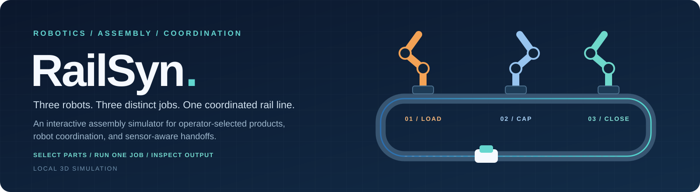

<div align="center">



[](#quick-start)
[](#controller-workflow)
[](#architecture)
[](#documentation)

</div>

---

## Overview

RailSyn brings three different robot operations into one inspectable assembly workflow. An operator chooses the exact cup/body, lower cap, and top cover from numbered trays. The robots retrieve those parts, assemble them on a rail-mounted carrier, and transfer the finished product to a collection conveyor.

The focus is on understanding **which part was selected, which robot owns the next operation, what permits a handoff, and where the completed product goes**. Selection, inventory, robot poses, process stages, sensor conditions, and output identities are exposed through the interface and run export.

Each **Run** executes one chosen assembly. After unloading and the empty carrier's return, RailSyn waits for the next explicit selection. There is no automatic part matching or unattended batch execution.

> **Project status:** research prototype, version 0.5.1. RailSyn simulates equipment; it does not command physical robots. Robot geometry is estimated, and arbitrary part combinations are not checked for real-world mechanical fit.

## Capabilities

| Area | Implemented behavior |
|---|---|
| Part selection | Choose individual B, C, and T source pockets through tray controls or the 3D scene; any in-stock type combination is permitted. |
| Robot specialization | Three articulated robots perform body loading, first-cap placement, and top-cover fitting with different modeled tools. |
| Rail transport | Separated workstations, a rectangular return route with rounded corners, and continuous empty-carrier return. |
| Product handling | Tracked parts, consumption after grip confirmation, double-stack cover pickup heights, and four persistent output pockets. |
| Controller | Per-robot selection, program execution, pause, stage stepping, six-joint manual jogging, tool controls, pose recording, and home recovery. |
| Sensors and holds | Synthetic vibration, settling checks, heartbeat freshness, grip/presence confirmation, and selectable fault scenarios. |
| External measurements | A local, read-only bridge can supply acceleration and confirmation flags without issuing robot motion commands. |
| Inspection and export | Optional inspection hold, visible process/I/O state, and JSON export of the current run snapshot. |

## Quick start

### Requirements

- **Node.js 22 or later**; npm is used only to invoke the included scripts.
- A modern browser with **WebGL** support.
- GitHub access to this private repository when cloning.

Three.js and the runtime 3D assets are bundled. Normal use requires no dependency installation, API key, cloud account, or Blender installation.

### Clone and launch

```sh
git clone https://github.com/Foysal-A-Al/railsyn.git
cd railsyn
npm start
```

Open **<http://127.0.0.1:8630>**.

On Windows, you can also double-click **`start.cmd`** after cloning. Existing shortcuts using `Start-RailSyn.cmd` and terminal commands using `node server.mjs` remain supported.

**Starting the server does not start an assembly.** Choose the parts and press Run in the application.

## Controller workflow

1. **Select the cup/body** from B1–B4.
2. **Select the first cap** from C1–C9.
3. **Select the top cover** from T1–T9. Cover pockets begin with two stacked pieces each.
4. **Choose the destination:** collect at the outfeed, or hold at inspection.
5. Press **Apply selection** to stage the recipe without motion, or **Run one selected assembly** to apply it and execute the job.
6. Follow the assembly through the three robot stations. With collection selected, the complete product moves to the output conveyor and the empty carrier returns to the loader.
7. **Choose again when ready.** The pending selection clears after completion; another assembly requires your selection and Run.

Mixed types are allowed. For example, **B2 + C1 + T3** is an accepted experimental recipe. This selects those actual source pockets; it does not establish that equivalent real parts would fit together.

### Controller reference

| Control | Purpose |
|---|---|
| **R1 / R2 / R3** | Select the robot whose joints, tool state, and TCP are shown. |
| **PROGRAM / MANUAL** | Execute the assembly sequence or operate permitted manual controls. |
| **Run / Resume** | Start the selected job at the loader, or continue a paused job. |
| **Pause / Step** | Pause execution, or advance one process stage with the required mode and drive conditions. |
| **Joint jog / Tool controls** | Jog the selected robot or actuate an empty tool in enabled manual mode. |
| **Recover home** | Restore modeled home poses after manual changes without replenishing stock or clearing collected products. |
| **Record pose / Export run** | Record the selected pose and download the current run snapshot. Recorded poses do not become a new motion program. |
| **SIM STOP / Clear simulation stop** | Latch the simulation stop, then acknowledge it without automatically restarting motion. |
| **Reset cell** | Reset the demonstration, including inventory and collected assemblies. |

For detailed mode requirements and recovery behavior, see the [user guide](docs/guide.md).

## Assembly line

| Station | Robot responsibility | Modeled end effector | Part source |
|---|---|---|---|
| **1 · Load** | Transfer the selected body into the carrier nest | Four-cup vacuum plate | B1–B4 body tray |
| **2 · Cap** | Pick and seat the selected first cap | Parallel jaws | C1–C9 cap tray |
| **3 · Close** | Pick and fit the selected top cover | Three-finger collet | T1–T9 double-stack tray |
| **Outfeed** | Lift and push the complete assembly onto the collection conveyor | Lift and lateral pusher | Completed carrier assembly |

Carrier indexing is blocked while a robot holds a part. The outfeed retains finished assembly IDs and source identities in four collection positions. Used stock remains depleted between separately selected jobs.

The station assignments and outfeed mechanism are proposed simulation designs informed by the reference photos and process description. They are not a calibrated reproduction of the lab's production program. Continuous multi-carrier scheduling and disassembly are not implemented.

## Architecture

The application runs as one local Node.js process serving a browser interface. It uses the Node.js standard library and bundled Three.js modules.

| Layer | Responsibility | Main files |
|---|---|---|
| **Browser workbench** | 3D rendering, source selection, controller controls, and state display | `public/app.js`, `public/index.html`, `public/style.css` |
| **Local API** | Serve allowlisted files, validate requests, accept simulation commands and measurement packets | `src/server.mjs` |
| **Simulation** | Advance process stages, coordinate robots/carrier, manage inventory and holds | `src/simulation.mjs` |
| **Shared model** | Keep catalog coordinates, robot kinematics, and rail geometry consistent between simulation and rendering | `public/catalog.mjs`, `public/kinematics.mjs`, `public/rail.mjs` |
| **Visual assets** | Supply estimated robot meshes and the studio lighting environment | `public/assets/`, `scripts/build-models.py` |

State is held **in memory** and resets when the server restarts. Export a run before closing the application if you need to retain its snapshot. Exports and internal browser-check output are excluded from Git.

The optional measurement bridge forwards data through the local HTTP ingress. It supplies measurements and confirmation flags, not desired joint positions. See the [integration contract](docs/integration.md) for packet format, token handling, units, sequence checks, and freshness limits.

## Repository structure

| Directory or file | Contents |
|---|---|
| `src/` | Server and simulation source |
| `public/` | Browser application and shared model modules |
| `public/assets/` | Bundled runtime model and HDR environment |
| `public/vendor/` | Third-party browser modules and license |
| `scripts/` | Blender model generator |
| `tests/unit/` | Simulation and asset regression tests |
| `tests/browser/` | Windows Chrome controller workflows |
| `docs/` | User guide, architecture, integration, research, validation, and credits |
| `docs/images/` | Project banner and documentation artwork |
| `start.cmd` | Windows launcher |
| `SECURITY.md` | Local security boundaries and reporting guidance |
| `CHANGELOG.md` | Version history |

## Development and verification

### Model and asset tests

From the repository root:

```sh
npm test
```

The suite covers selection and inventory, three distinct robot jobs, source identity propagation, FK/IK agreement, grip and transport conditions, outfeed persistence, continuous return motion, sensor holds, manual recovery, and stop behavior.

### Browser workflows

On Windows, with Chrome installed at its standard path and the server already running:

```sh
npm run test:selection
npm run test:stop
```

These checks use a separate headless Chrome profile. **They reset and operate the demonstration**, so run them when the current simulation state can be replaced. Screenshots and results are written under ignored `.qa/`.

**Recorded evidence:** version 0.5.0 passed 31 model tests and the mixed-part Windows Chrome selection workflow. Version 0.5.1 received source-relocation, import-path, and documentation-link checks; its runtime tests were not rerun during the organization update. See [validation](docs/validation.md) for the exact scope and limitations.

### Rebuild the robot meshes

Blender is needed only when editing and regenerating the concept models:

```sh
blender -b --python scripts/build-models.py
```

Run this from the repository root. It replaces `public/assets/cell-models.glb`.

## Scope and limitations

RailSyn is useful for exploring explicit selection, process ownership, sensor-conditioned handoffs, and failure/recovery behavior. It currently uses deterministic coordination logic, rather than a trained AI model. Its proposed research contribution and performance benefits remain unproven; [research notes](docs/research.md) describe the hypothesis and relevant prior art.

The simulator does not include a physics engine, contact/gravity dynamics, grip-force calculation, continuous collision detection, manufacturer-calibrated geometry or IK, or real-time motion guarantees. The presence check does not validate mechanical compatibility. Synthetic sensor settings and thresholds are illustrative.

No real robot driver is included. The physical-command endpoint rejects requests, and **SIM STOP is not a physical emergency stop**. The local server binds to `127.0.0.1:8630` and uses request-origin checks, a per-process mutation token, bounded JSON input, and a fixed static-file allowlist. Keep the prototype local; see [security boundaries](SECURITY.md).

## Documentation

| Document | Read it for |
|---|---|
| [User guide](docs/guide.md) | Selecting parts, operating the controller, recovering after manual changes, and collecting products |
| [Architecture](docs/architecture.md) | Runtime responsibilities, file conventions, and model generation |
| [Integration](docs/integration.md) | Read-only sensor packets and external-bridge boundaries |
| [Validation](docs/validation.md) | Recorded checks, reproducible commands, and remaining verification gaps |
| [Research](docs/research.md) | Proposed coordination hypothesis, prior art, and evaluation direction |
| [Credits](docs/credits.md) | Asset provenance and third-party licenses |
| [Change history](CHANGELOG.md) | Versioned changes |

## Maintainer and licensing

Maintained by **Abdullah Al Foysal** · [Foysal-A-Al](https://github.com/Foysal-A-Al).

This is a private research repository. No open-source license has been assigned to the project code. Third-party terms remain applicable: Three.js is distributed under its [MIT license](public/vendor/THREE-LICENSE.txt), and the bundled Poly Haven environment is CC0. The robot meshes are project-created estimates, not manufacturer CAD. Full attribution is recorded in [credits](docs/credits.md).
